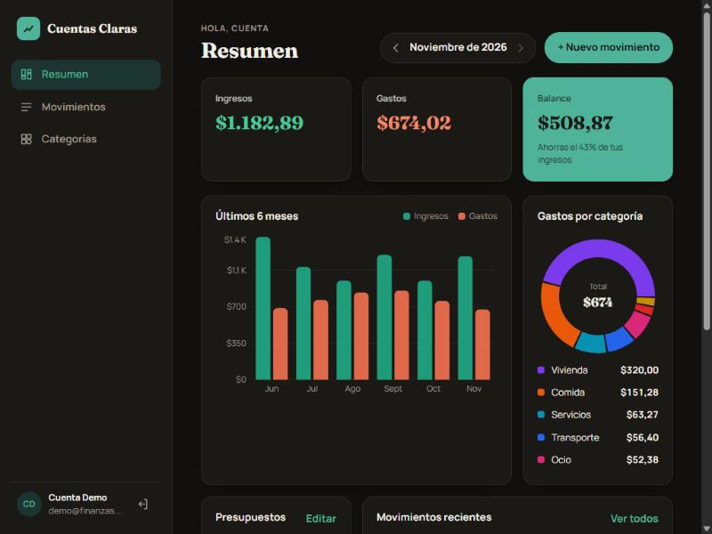

# Cuentas Claras

Aplicación web full-stack para controlar las finanzas personales: registra ingresos y gastos, organízalos por categorías, fija presupuestos mensuales y visualiza en qué se va tu dinero.


**[Ver demo en vivo →](https://finanzas-app-six-sigma.vercel.app)** · Cuenta demo: `demo@finanzas.app` / `demo12345`

> La API está en el plan gratuito de Render: si lleva un rato sin uso, el primer inicio de sesión puede tardar hasta un minuto.

<p align="center">
  
</p>

## Funcionalidades

- **Cuentas de usuario** con registro, inicio de sesión y contraseñas cifradas (bcrypt + JWT).
- **Movimientos**: crear, editar y borrar ingresos y gastos; filtrar por mes, tipo, categoría o texto.
- **Categorías personalizables** con color y **presupuesto mensual** opcional.
- **Panel de resumen**: balance y tasa de ahorro del mes, evolución de los últimos 6 meses, gráfico de gastos por categoría y progreso de cada presupuesto (avisa al 80 % y al 100 %).
- **Diseño responsive** con modo claro y oscuro automático.
- **Cuenta demo** con 6 meses de datos realistas.

## Tecnologías

| Capa | Herramientas |
| --- | --- |
| Frontend | React 19, TypeScript, React Router, Recharts, Vite |
| Backend | Node.js, Express 5, TypeScript, Zod (validación) |
| Base de datos | PostgreSQL (en local con [PGlite](https://pglite.dev), sin instalar nada) |
| Seguridad | bcrypt, JWT, Helmet, CORS, límite de intentos de login |
| Calidad | Vitest + Supertest, GitHub Actions |

## Decisiones técnicas

- **Mismo SQL en local y en producción.** La capa `server/src/db.ts` usa PGlite (PostgreSQL compilado a WebAssembly) si no hay `DATABASE_URL`, y un PostgreSQL real si la hay. Así cualquiera puede clonar y ejecutar el proyecto sin instalar una base de datos, y los tests corren contra PostgreSQL de verdad.
- **SQL escrito a mano** con consultas parametrizadas (`$1, $2…`), sin ORM. Los resúmenes usan agregaciones con `FILTER`, `generate_series` y `LEFT JOIN` para incluir meses sin movimientos.
- **Aislamiento entre usuarios.** Todas las consultas filtran por `user_id` y se comprueba que la categoría de un movimiento pertenezca al usuario; hay tests específicos para ello.
- **Importes como `NUMERIC(12,2)`** en la base de datos para evitar errores de redondeo con decimales.

## Ejecutar en local

Requisitos: Node.js 20.6 o superior.

```bash
git clone https://github.com/dylannkeys/finanzas-app.git
cd finanzas-app
npm install
npm run seed   # crea la cuenta demo (opcional)
npm run dev    # API en :3001 y web en http://localhost:5173
```

Cuenta demo: `demo@finanzas.app` / `demo12345`

### Otros comandos

| Comando | Qué hace |
| --- | --- |
| `npm test` | Tests de la API (usan una base PGlite en memoria) |
| `npm run lint` | Comprobación de tipos en servidor y cliente |
| `npm run build` | Compila servidor (`server/dist`) y cliente (`client/dist`) |

## API

Todas las rutas, salvo las de autenticación, requieren la cabecera `Authorization: Bearer <token>`.

| Método | Ruta | Descripción |
| --- | --- | --- |
| `POST` | `/api/auth/register` | Crear cuenta |
| `POST` | `/api/auth/login` | Iniciar sesión |
| `GET` | `/api/auth/me` | Usuario actual |
| `GET` | `/api/summary?month=AAAA-MM` | Totales, gasto por categoría e historial de 6 meses |
| `GET` | `/api/transactions?month=&type=&categoryId=&q=` | Listar movimientos con filtros |
| `POST` `PUT` `DELETE` | `/api/transactions/:id` | Crear, editar y borrar movimientos |
| `GET` `POST` `PUT` `DELETE` | `/api/categories/:id` | Gestionar categorías y presupuestos |

## Despliegue gratuito

1. **Base de datos**: crea un proyecto en [Neon](https://neon.tech) y copia la cadena de conexión.
2. **API** en [Render](https://render.com): *New → Blueprint* y elige el repositorio. El archivo [`render.yaml`](render.yaml) lo configura todo (genera `JWT_SECRET` y regenera la cuenta demo en cada arranque con `SEED_DEMO=1`). Solo pide `DATABASE_URL` y `CLIENT_ORIGIN` (la URL del frontend).
3. **Frontend** en [Vercel](https://vercel.com): importa el repositorio con directorio raíz `client` y la variable `VITE_API_URL` con la URL de la API. [`client/vercel.json`](client/vercel.json) redirige las rutas de la app a `index.html`.

> En el plan gratuito de Render la API se suspende tras un rato sin uso; la primera petición puede tardar unos segundos.

## Estructura

```
finanzas-app/
├── client/            # React + TypeScript (Vite)
│   └── src/
│       ├── pages/       # Resumen, Movimientos, Categorías, Login
│       ├── components/  # Layout, formularios, modal, selector de mes
│       └── api.ts       # Cliente HTTP tipado
├── server/            # API Express + TypeScript
│   ├── src/
│   │   ├── routes/      # auth, transactions, categories, summary
│   │   ├── db.ts        # PostgreSQL / PGlite
│   │   └── schema.ts    # Tablas e índices
│   └── tests/         # Tests de integración de la API
└── .github/workflows/ # CI
```

## Licencia

[MIT](LICENSE)
